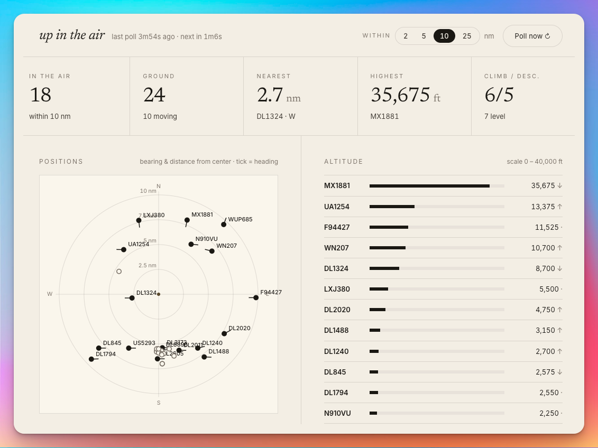
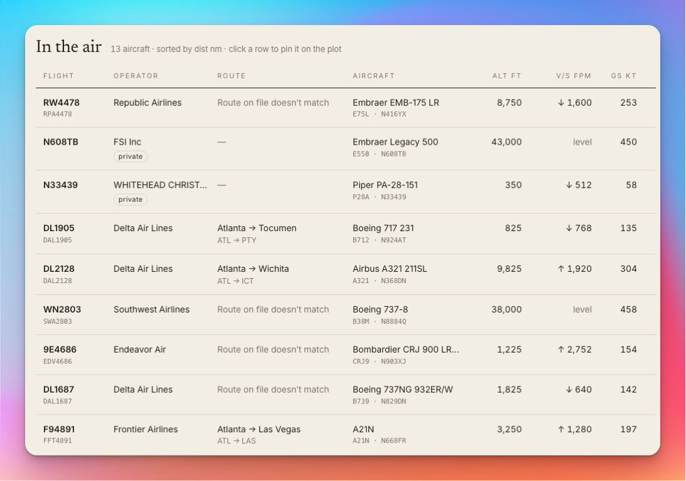
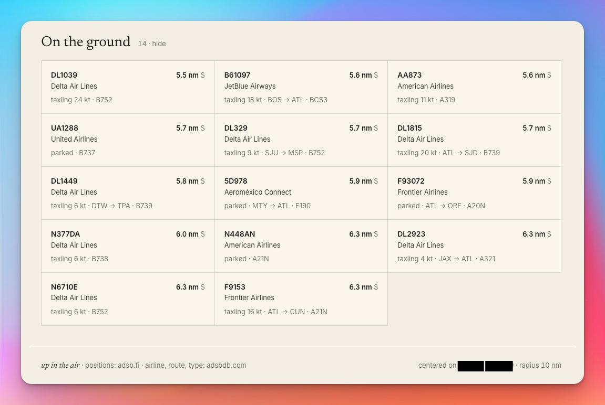

# up in the air

A small web app that lists aircraft near a point you choose: airline, flight, route, aircraft type, altitude, climb/descent, speed, heading and distance. It has a compass plot, an altitude ladder, a sortable table and a list of what's on the ground. No photos or map tiles: just the data and a few simple charts.

It runs as one Docker container. It needs no API keys or accounts and no hardware such as an ADS-B receiver: positions come from free public ADS-B feeds.

Inspired by [dmellok's tesserae widget project](https://github.com/dmellok/tesserae-widget-overhead).



---

## Install

You need **Docker** with Compose (Docker Desktop, Colima, OrbStack, or Docker Engine on Linux) and an internet connection.

### 1. Get the code

```bash
git clone <this repository's URL> up-in-the-air
cd up-in-the-air
```

### 2. Set your location

```bash
cp .env.example .env
```

Open `.env` and fill in `LAT` and `LON`: the point to watch, in decimal degrees. To find them, right-click the spot in Google Maps and click the coordinates at the top of the menu to copy them. South latitudes and west longitudes are negative:

```dotenv
LAT=48.8584
LON=2.2945
```

Leave everything else alone for now. The container won't start without a valid `LAT` and `LON`.

### 3. Start it

```bash
docker compose up -d --build
```

On older installs the command is `docker-compose` (with a hyphen). The first build takes a minute or two.

### 4. Open it

Go to **http://localhost:9030/**, or `http://<that machine's IP>:9030/` from another device on your network.

The first load shows the planes straight away. Airline, route and aircraft details fill in over the next few seconds, and the page says when it's still looking things up.

That's the whole install.

---

## Everyday use

| | |
|---|---|
| **Radius** | The **Within 2 · 5 · 10 · 25 nm** buttons. Each browser remembers its own choice, and `?nm=10` in the URL sets it directly, so you can bookmark it. |
| **Refresh** | Automatic every 5 minutes. **Poll now ↻** asks straight away; it's ignored if the last poll was under 15 seconds ago. |
| **Highlight** | Hover a plane in the plot, ladder or table to highlight it everywhere. Click to pin it. |
| **Sort** | Click a table heading. |

```bash
docker compose logs -f          # watch the logs
docker compose down             # stop it
git pull && docker compose up -d --build   # update to a newer version
```

---

## Settings (`.env`)

After changing `.env`, run `docker compose up -d` to apply it.

| Setting | Default | What it does |
|---|---|---|
| `LAT`, `LON` | *(required)* | The centre point, in decimal degrees. |
| `RADIUS_NM` | `5` | The radius the page opens at: `2`, `5`, `10` or `25`. |
| `MAX_RADIUS_NM` | `25` | The radius asked of the feed. Choices above it are hidden. |
| `REFRESH_S` | `300` | Seconds between feed polls. **Keep it at 60 or more** (see below). |
| `TZ` | `UTC` | Timezone for log timestamps. |

To use a port other than 9030, change the left side of `ports:` in `docker-compose.yml`, e.g. `"8080:9030"`.

---

## Where the data comes from (please be polite to it)

| Data | Source | Limits |
|---|---|---|
| Positions | [adsb.fi](https://adsb.fi/) open data (main) and [adsb.lol](https://adsb.lol/) (fallback) | adsb.fi: 1 request/second, personal non-commercial use. adsb.lol: **500 requests per IP per day**. |
| Airline, route, aircraft type, owner | [adsbdb.com](https://www.adsbdb.com/) | Free; each answer is cached for days (see below). |

These are free, volunteer-run services. The app is built to be a light user of them:

- **Feeds are polled at most once per `REFRESH_S`,** however many browsers are open. Every radius is cut from that one answer, so changing the radius never causes another poll.
- **adsbdb answers are cached** in `./data/lookups.sqlite`: routes for 7 days, aircraft for 30 days, and "unknown" answers for 1 day. At most 16 new lookups are made per refresh. The file is only a cache and is safe to delete.
- **A feed that says "too many requests" is skipped** until the time it gives for its limit to reset.

Lowering `REFRESH_S` a lot will get you rate-limited, adsb.lol first. Other apps on the same network that use the same feeds, such as other plane trackers, count against the same per-IP limits.

**Routes are best-effort.** adsbdb stores one route per flight number, and airlines reuse flight numbers across different legs. The app hides a route when the plane can't be flying it (it isn't between the two airports, or it's heading away from the destination), and shows "Route on file doesn't match" instead. Near a busy hub this is common.

The footer credits the data sources. Please keep that credit if you change the page.

---

## Changing it

```
app.py                Flask server: feed polling, adsbdb lookups and cache, /api/planes, /api/poll
templates/index.html  the page skeleton
frontend/src/main.ts  everything the page draws (TypeScript, bundled with esbuild at image build time)
static/style.css      layout
static/ds/            colour/type tokens (CSS variables: --bg, --ink, --accent, --serif …)
Dockerfile            builds the TypeScript, then runs gunicorn on port 9030
```

To restyle the page, start with `static/ds/colors.css` and `static/ds/typography.css`. After any change, run `docker compose up -d --build`.

It's served by **one gunicorn worker on purpose**: the poll throttle lives in that process. Don't add `-w`. More threads are fine.

The JSON the page uses is at `/api/planes?nm=5`, if you want to build something else on it.





